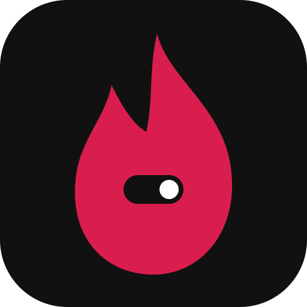

<p align="center">
  
</p>

<h1 align="center">RageKit</h1>

<p align="center">Desktop apps in PHP, compiled to native code and drawn on the GPU. No browser engine.</p>

You write screens as PHP classes and their layout as small `.rk` templates. RageKit compiles the
PHP to machine code with [TypePHP](https://github.com/swoole/typephp), turns the templates into a
[Slint](https://slint.dev) UI, and produces an ordinary executable.

```sh
composer create-project ragekit/starter myapp
```

| Repository | What it is |
|---|---|
| [ragekit](https://github.com/ragekit-php/ragekit) | the framework: runtime, build CLI, kits (shadcn, Material) and native modules |
| [ragekit-starter](https://github.com/ragekit-php/ragekit-starter) | a new app, ready to build |

**Status: experimental (0.x).** Linux is where it's built and tested. Windows works but is tested
less. macOS isn't supported yet. Apps built with RageKit are GPLv3.

[Get started](https://github.com/ragekit-php/ragekit/blob/master/docs/getting-started.md) ·
[Templates](https://github.com/ragekit-php/ragekit/blob/master/docs/templates.md) ·
[Changelog](https://github.com/ragekit-php/ragekit/blob/master/CHANGELOG.md)
